# Informe del Segundo Examen Parcial

---

# Portada

UNIVERSIDAD MAYOR, REAL Y PONTIFICIA DE SAN FRANCISCO XAVIER DE CHUQUISACA

FACULTAD DE CIENCIAS Y TECNOLOGÍA

**Nombre:** VALDA PLAZA CAMILA MONSERRAT

**Carrera:** INGENIERÍA DE SISTEMAS

**Asignatura:** Trabajando en la Nube (COM610)

**Docente:** Ing. Marcelo Quispe Ortega

**Evaluación:** Segundo examen parcial

**Semestre:** 2/2026

SUCRE, BOLIVIA

---

## Contenido

- [Datos de la entrega](#datos-de-la-entrega)
- [Ejercicio 1: API REST en EC2 con base de datos RDS](#ejercicio-1-api-rest-en-ec2-con-base-de-datos-rds)
  - [1.1 Red y grupos de seguridad](#11-red-y-grupos-de-seguridad)
  - [1.2 Instancia EC2 y Elastic IP](#12-instancia-ec2-y-elastic-ip)
  - [1.3 Instancia RDS sin acceso público](#13-instancia-rds-sin-acceso-público)
  - [1.4 Conexión privada, tabla libros y usuario de la API](#14-conexión-privada-tabla-libros-y-usuario-de-la-api)
  - [1.5 Código de la API](#15-código-de-la-api)
  - [1.6 Despliegue en la EC2](#16-despliegue-en-la-ec2)
  - [1.7 Nginx como proxy inverso](#17-nginx-como-proxy-inverso)
  - [1.8 Verificación externa del CRUD y persistencia](#18-verificación-externa-del-crud-y-persistencia)
- [Ejercicio 2: CI/CD para la API](#ejercicio-2-cicd-para-la-api)
  - [2.1 Pruebas automatizadas sin RDS](#21-pruebas-automatizadas-sin-rds)
  - [2.2 Workflow de CI](#22-workflow-de-ci)
  - [2.3 Dockerfile y prueba local](#23-dockerfile-y-prueba-local)
  - [2.4 Preparación de la EC2](#24-preparación-de-la-ec2)
  - [2.5 Credenciales como secrets](#25-credenciales-como-secrets)
  - [2.6 Workflow de CD](#26-workflow-de-cd)
  - [2.7 Primer despliegue automático](#27-primer-despliegue-automático)
  - [2.8 Cambio visible de versión](#28-cambio-visible-de-versión)
  - [2.9 Prueba de fallo: se conserva la versión anterior](#29-prueba-de-fallo-se-conserva-la-versión-anterior)
  - [2.10 Pull request: el CI falla y no se despliega](#210-pull-request-el-ci-falla-y-no-se-despliega)
- [Cumplimiento de requisitos](#cumplimiento-de-requisitos)
- [Conclusiones](#conclusiones)

---

## Datos de la entrega

- **Repositorio:** https://github.com/CamilaMonserratValdaPlaza26/com610-2do-parcial
- **URL pública de la API:** http://52.200.202.166 (rutas /health y /libros)
- **Ejecución exitosa de CI:** https://github.com/CamilaMonserratValdaPlaza26/com610-2do-parcial/actions/runs/44635262211
- **Ejecución exitosa de CD (primer despliegue):** https://github.com/CamilaMonserratValdaPlaza26/com610-2do-parcial/actions/runs/44641776176
- **Ejecución exitosa de CD (versión 2.0.0):** https://github.com/CamilaMonserratValdaPlaza26/com610-2do-parcial/actions/runs/44644853092

Todas las capturas, con una explicación de cada una, están en [evidencias/README.md](evidencias/README.md). En las capturas se taparon las contraseñas y la IP del equipo local, y lo importante se marcó con un recuadro gris y una flecha.

---

# Ejercicio 1: API REST en EC2 con base de datos RDS

**Objetivo:** publicar una API de libros en Amazon EC2 que guarde los datos en Amazon RDS for MySQL, sin exponer la base de datos ni el puerto de la aplicación a Internet.

Todos los recursos se crearon en la región **us-east-1 (Norte de Virginia)**, en la VPC predeterminada vpc-0e74f945b159d53ec, y se identificaron con las iniciales **CMVP**.

## 1.1 Red y grupos de seguridad

Se crearon **dos grupos de seguridad separados**, uno para cada recurso.

**Grupo de la EC2 (CMVP-ec2-sg).** Tiene dos reglas de entrada:

- **SSH, puerto 22, origen "Mi IP" (/32):** solo el equipo local puede administrar el servidor. El /32 significa una sola dirección IP.
- **HTTP, puerto 80, origen 0.0.0.0/0:** cualquier persona en Internet puede usar la API.

No se abrieron los puertos 3000 (Node.js) ni 3306 (MySQL).

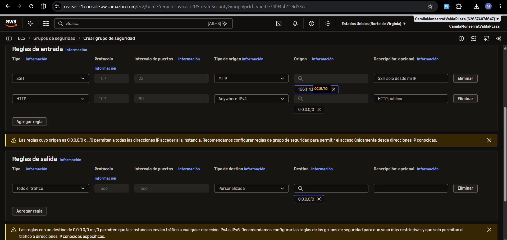

*En la captura se ven las dos únicas reglas. La IP del equipo local está tapada.*

**Grupo de RDS (CMVP-rds-sg).** Tiene una sola regla de entrada: **MySQL/Aurora, puerto 3306**, cuyo origen es el **grupo de seguridad de la EC2** (sg-0b24bdf2736ade74f) y no una IP. Así, solo las instancias que pertenecen a CMVP-ec2-sg pueden conectarse a la base.

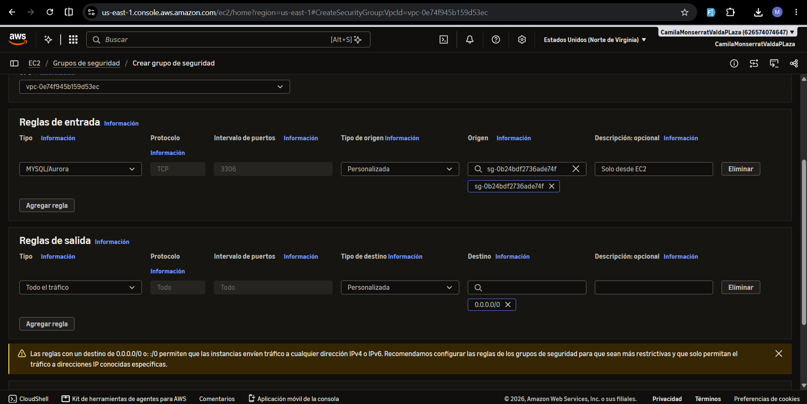

## 1.2 Instancia EC2 y Elastic IP

- **Instancia:** CMVP-ec2-libros, Ubuntu Server 24.04 LTS, tipo t3.micro, disco gp3 de 16 GiB, par de claves CMVP-key y grupo CMVP-ec2-sg.
- **Elastic IP:** CMVP-eip (52.200.202.166). La IP pública normal cambia cuando la instancia se reinicia; la Elastic IP no, así la URL de la API se mantiene durante la revisión.

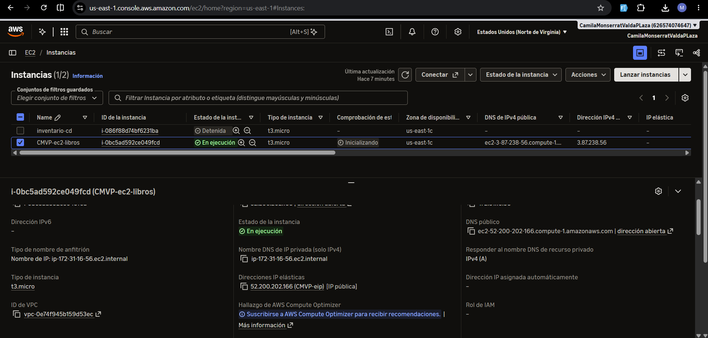

*La captura muestra la Elastic IP 52.200.202.166 (CMVP-eip) y la VPC de la instancia.*

Para conectarse desde el equipo local se usó:

**Comando:** ssh -i "CMVP-key.pem" ubuntu@52.200.202.166

- **ssh**: programa para abrir una terminal remota cifrada.
- **-i "CMVP-key.pem"**: indica el archivo de clave privada que reemplaza a la contraseña.
- **ubuntu@52.200.202.166**: usuario de la instancia (ubuntu) y su dirección IP.

En Windows hubo que restringir los permisos del archivo .pem, porque SSH rechaza claves que otros usuarios pueden leer:

**Comando:** icacls "CMVP-key.pem" /inheritance:r

**Comando:** icacls "CMVP-key.pem" /grant:r "$($env:USERNAME):(R)"

- **/inheritance:r**: quita los permisos heredados de la carpeta.
- **/grant:r "USUARIO:(R)"**: deja solo al usuario actual con permiso de lectura.

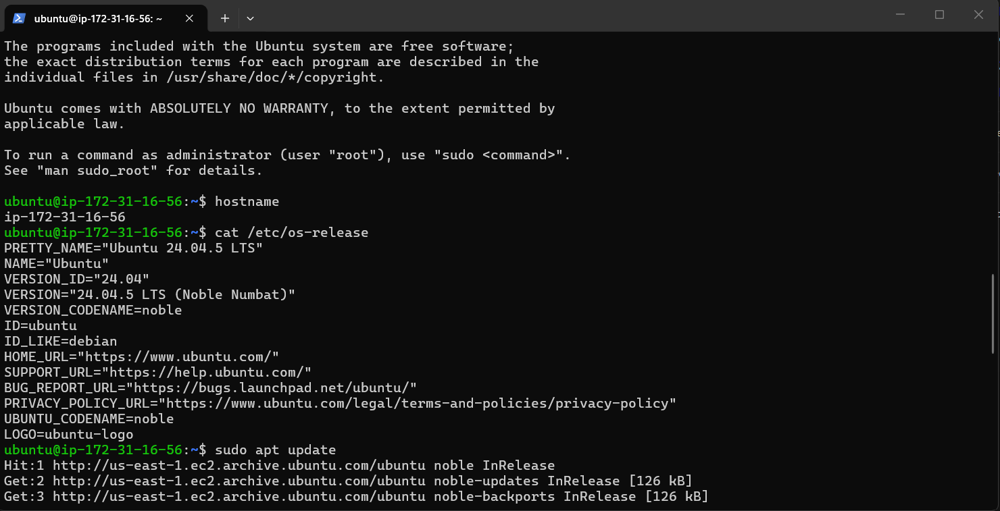

*hostname y cat /etc/os-release confirman que la sesión está dentro del servidor y que el sistema es Ubuntu 24.04.5.*

## 1.3 Instancia RDS sin acceso público

Se creó la base de datos con **configuración completa**, para elegir manualmente la red y la seguridad:

- **Motor:** MySQL Community 8.4, plantilla de capa gratuita, clase db.t3.micro.
- **Identificador:** cmvp-rds-libros, usuario maestro admin.
- **Conectividad:** misma VPC que la EC2 y **Acceso público: No**. RDS no recibe una IP pública y solo es accesible desde dentro de la VPC.
- **Grupo de seguridad:** solo CMVP-rds-sg (se quitó el default).
- **Base de datos inicial:** db_libros.

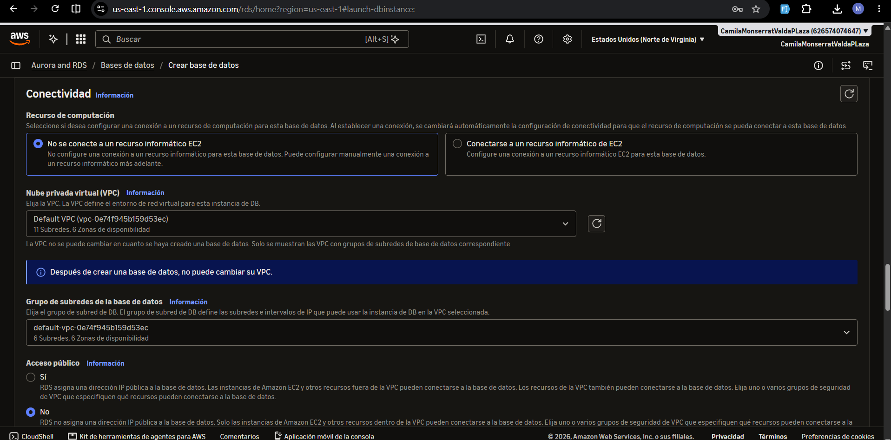

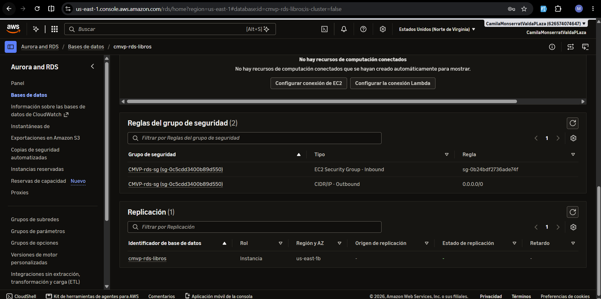

*Con la RDS ya creada, la regla de entrada confirma que el origen del puerto 3306 es el grupo de la EC2.*

## 1.4 Conexión privada, tabla libros y usuario de la API

Desde la EC2 se instaló el cliente de base de datos y se descargó el certificado de RDS para cifrar la conexión:

**Comando:** sudo apt install -y mariadb-client

**Comando:** curl -o global-bundle.pem https://truststore.pki.rds.amazonaws.com/global/global-bundle.pem

- **sudo apt install -y mariadb-client**: instala el programa mariadb para conectarse a MySQL. -y acepta la instalación sin preguntar.
- **curl -o global-bundle.pem URL**: descarga el certificado público de AWS RDS y lo guarda (-o) con ese nombre.

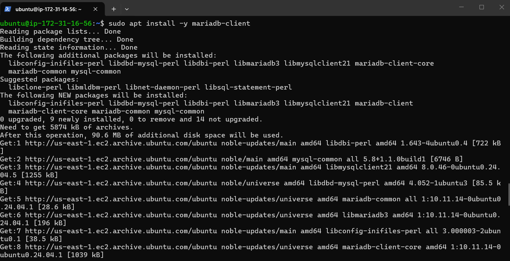

*Instalación del cliente mariadb en la EC2.*

**Comando:** mariadb -h cmvp-rds-libros.ccxy284oaq7g.us-east-1.rds.amazonaws.com -P 3306 -u admin -p --ssl-verify-server-cert --ssl-ca=./global-bundle.pem

- **-h**: endpoint de RDS, es decir, la dirección de la base de datos.
- **-P 3306**: puerto de MySQL.
- **-u admin**: usuario con el que se inicia sesión.
- **-p**: pide la contraseña sin mostrarla en pantalla.
- **--ssl-verify-server-cert** y **--ssl-ca**: cifran la conexión y verifican que el servidor sea realmente RDS, usando el certificado descargado.

La conexión funciona solo desde la EC2, porque la regla 3306 únicamente acepta su grupo de seguridad.

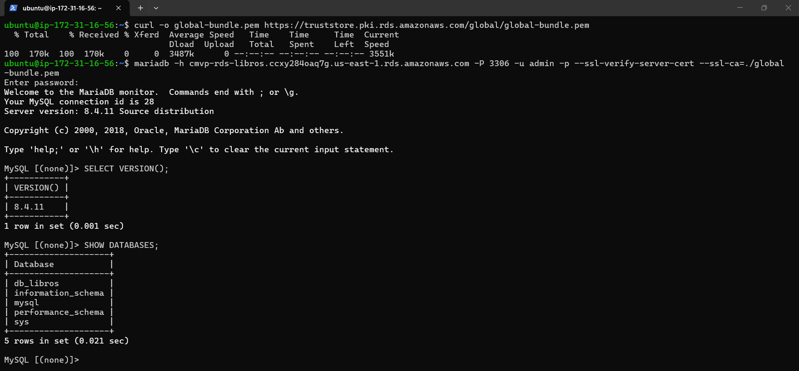

**Tabla libros.** El archivo db.sql del repositorio crea la base y la tabla:

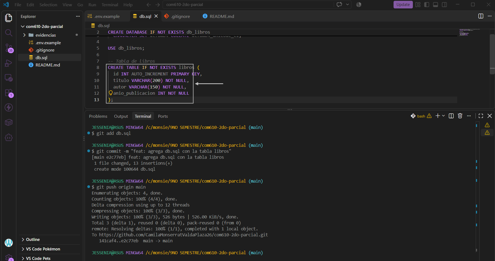

*Contenido de db.sql: crea la base db\_libros y la tabla libros con id, titulo, autor y anio\_publicacion.*

- **IF NOT EXISTS**: evita errores si la base o la tabla ya existen.
- **utf8mb4**: permite guardar acentos y cualquier carácter.
- **AUTO_INCREMENT PRIMARY KEY**: RDS asigna el id automáticamente y no se repite.
- **NOT NULL**: la base no acepta campos vacíos, como respaldo de la validación de la API.

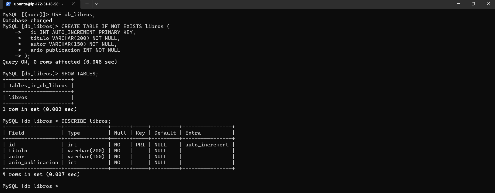

*DESCRIBE libros muestra las cuatro columnas que pide el enunciado.*

**Usuario de la API.** La aplicación no usa el usuario admin; se creó uno con permisos solo sobre db_libros:

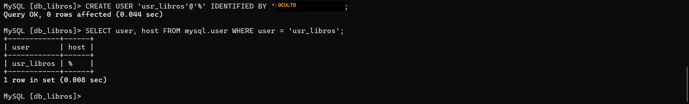

*Creación del usuario usr\_libros; la contraseña está tapada.*

- **CREATE USER ... '%'**: crea el usuario; % le permite conectarse desde cualquier equipo de la VPC.
- **GRANT ... ON db_libros.***: le da permisos solo sobre las tablas de db_libros.
- **FLUSH PRIVILEGES**: aplica los permisos de inmediato.

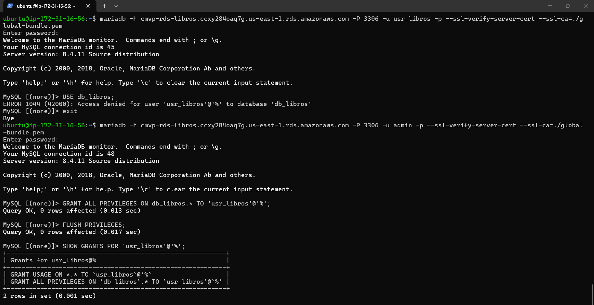

*SHOW GRANTS confirma que el usuario solo tiene acceso a db_libros.*

## 1.5 Código de la API

La API está hecha con **Node.js y Express** y se organiza en cuatro archivos:

- **server.js**: carga el .env con dotenv y arranca el servidor en el puerto de la variable PORT.
- **src/app.js**: define los endpoints, la validación y los códigos HTTP.
- **src/librosRepo.js**: contiene todas las consultas SQL.
- **src/db.js**: crea el pool de conexiones a RDS con las variables DB_HOST, DB_PORT, DB_USER, DB_PASSWORD, DB_NAME y DB_SSL.

**Endpoints:**

- **GET /health**: responde 200 con status, version y commit.
- **GET /libros**: lista los libros guardados en RDS (200).
- **GET /libros/:id**: devuelve un libro (200) o 404 si no existe.
- **POST /libros**: crea un libro y responde 201 con el registro creado.
- **PUT /libros/:id**: actualiza un libro (200) o responde 404 si no existe.
- **DELETE /libros/:id**: elimina un libro (200) o responde 404 si no existe.

**Validación (400):** titulo y autor no pueden estar vacíos y anio_publicacion debe ser un número entero entre 1 y el año actual. También se rechaza un id que no sea un entero positivo.

**Consultas parametrizadas:** todas las consultas usan ?, por ejemplo:

**Código:** pool.execute('SELECT id, titulo, autor, anio\_publicacion FROM libros WHERE id = ?', [id]);

El valor de id viaja aparte del texto SQL, así un dato malicioso no puede modificar la consulta (inyección SQL).

## 1.6 Despliegue en la EC2

**Comando:** curl -fsSL https://deb.nodesource.com/setup\_20.x | sudo -E bash -

**Comando:** sudo apt install -y nodejs git nginx

- La primera línea descarga el instalador oficial de Node.js 20 y agrega su repositorio al sistema.
- La segunda instala Node.js, Git y Nginx.

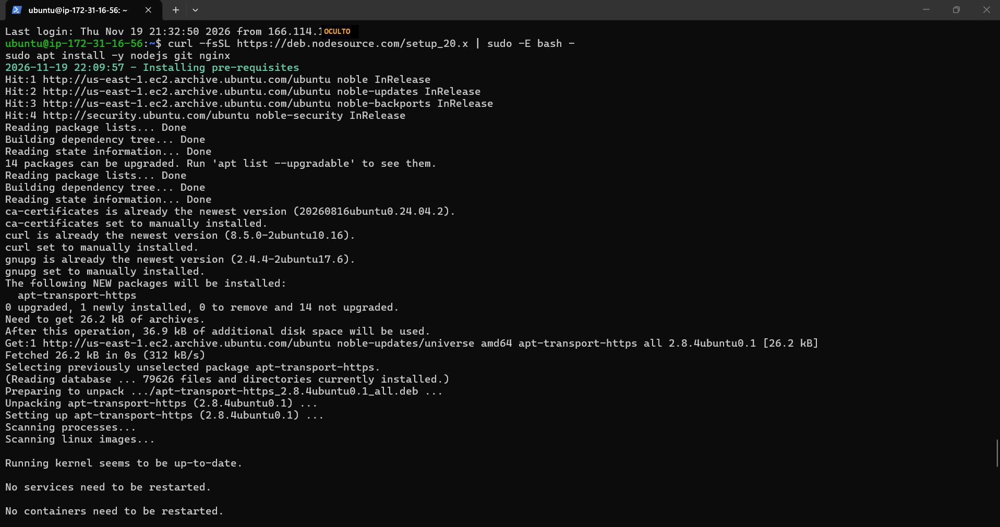

*Instalación de Node.js 20, Git y Nginx en la EC2.*

**Comando:** git clone https://github.com/CamilaMonserratValdaPlaza26/com610-2do-parcial.git

**Comando:** cd com610-2do-parcial

**Comando:** npm ci --omit=dev

- **git clone**: descarga el código del repositorio.
- **npm ci --omit=dev**: instala exactamente las versiones de package-lock.json, sin las herramientas de desarrollo.

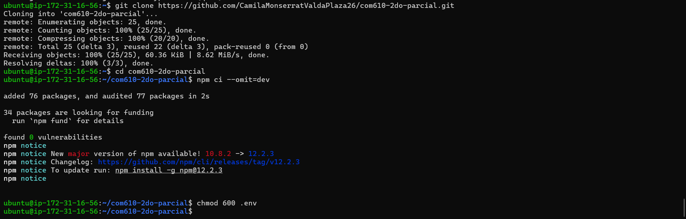

*Clonación del repositorio, instalación de dependencias y protección del .env con chmod 600.*

**Comando:** cp .env.example .env

**Comando:** nano .env

**Comando:** chmod 600 .env

- **cp**: copia la plantilla para crear el .env real.
- **nano**: editor donde se escribió el endpoint de RDS y la contraseña del usuario de la API.
- **chmod 600**: solo el usuario ubuntu puede leer y modificar el archivo.

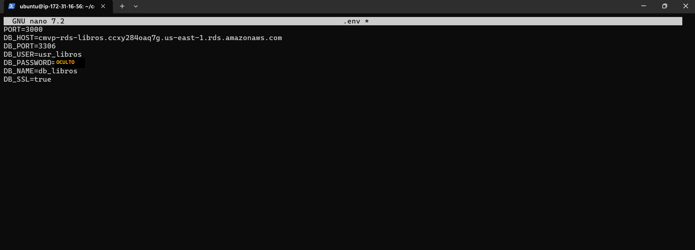

*El .env solo existe en la EC2; la contraseña está tapada en la captura.*

En el ejercicio 1 la API se ejecutó con **PM2**, que la mantiene encendida en segundo plano:

**Comando:** sudo npm install --global pm2

**Comando:** pm2 start server.js --name api-libros

**Comando:** pm2 save

**Comando:** pm2 startup

- **pm2 start ... --name api-libros**: arranca la API y le da un nombre.
- **pm2 save** y **pm2 startup**: hacen que la API vuelva a arrancar sola si la EC2 se reinicia.

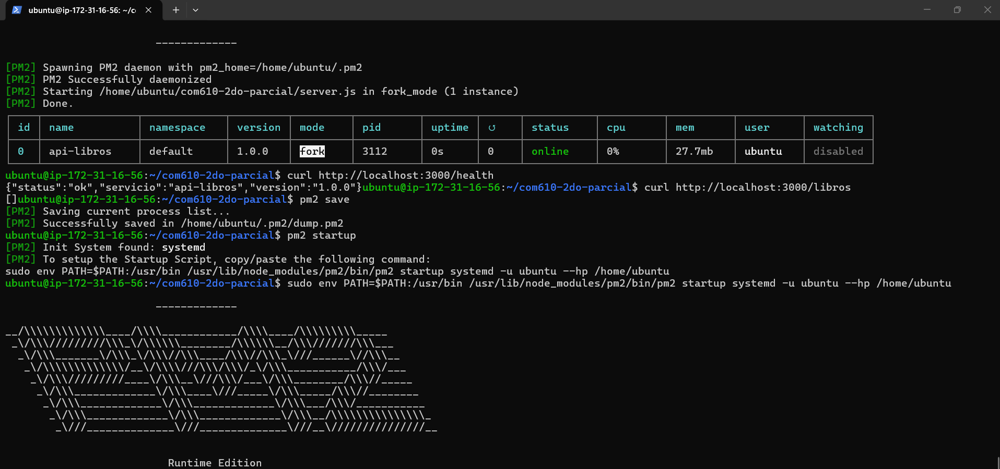

*La API corre con PM2; /health y /libros responden dentro de la EC2.*

En el ejercicio 2, PM2 se reemplazó por un contenedor Docker (sección [2.4](#24-preparación-de-la-ec2)).

## 1.7 Nginx como proxy inverso

Nginx recibe las peticiones de Internet en el puerto 80 y se las pasa a la API, que escucha solo dentro de la EC2. Archivo /etc/nginx/sites-available/libros-api:

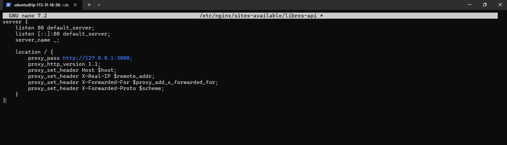

*Archivo /etc/nginx/sites-available/libros-api: escucha en el puerto 80 y reenvía a 127.0.0.1:3000.*

- **listen 80**: escucha en el puerto HTTP.
- **proxy_pass http://127.0.0.1:3000**: reenvía cada petición a la API local.
- **proxy_set_header**: conserva datos del cliente original, como su IP y el dominio pedido.

**Comando:** sudo ln -s /etc/nginx/sites-available/libros-api /etc/nginx/sites-enabled/libros-api

**Comando:** sudo rm /etc/nginx/sites-enabled/default

**Comando:** sudo nginx -t

**Comando:** sudo systemctl reload nginx

- **ln -s**: activa el sitio creando un acceso directo en sites-enabled.
- **rm .../default**: quita la página de bienvenida de Nginx.
- **nginx -t**: revisa que la configuración no tenga errores antes de aplicarla.
- **systemctl reload nginx**: aplica la configuración sin apagar el servicio.

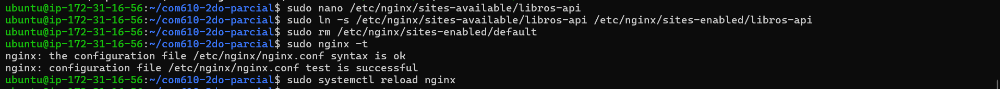

*nginx -t confirma que la configuración es correcta antes de recargar.*

## 1.8 Verificación externa del CRUD y persistencia

Las pruebas se hicieron desde el **equipo local** con curl, contra la IP pública y el puerto 80.

**Crear un libro:**

**Comando:** curl -i -X POST http://52.200.202.166/libros -H "Content-Type: application/json" -d '{"titulo":"Rayuela","autor":"Julio Cortazar","anio\_publicacion":1963}'

- **curl**: programa que envía peticiones HTTP desde la terminal.
- **-i**: muestra también las cabeceras de la respuesta, como el código HTTP y el servidor.
- **-X POST**: indica el método HTTP; POST sirve para crear.
- **-H "Content-Type: application/json"**: avisa a la API que los datos van en formato JSON.
- **-d '{...}'**: los datos del libro que se envían.

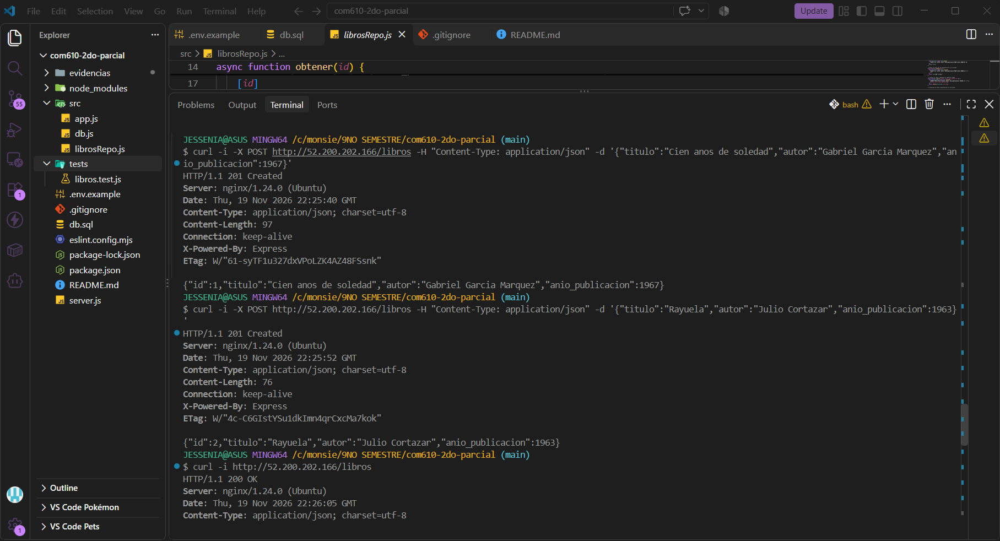

*Las dos creaciones responden **201 Created** con el id asignado por RDS. La cabecera Server: nginx demuestra que la petición pasó por Nginx.*

**Consultar y actualizar:**

**Comando:** curl -i http://52.200.202.166/libros

**Comando:** curl -i -X PUT http://52.200.202.166/libros/1 -H "Content-Type: application/json" -d '{"titulo":"Cien anos de soledad (Edicion RAE)","autor":"Gabriel Garcia Marquez","anio\_publicacion":1967}'

- Sin -X, curl usa **GET**, que sirve para consultar.
- **-X PUT .../libros/1**: reemplaza los datos del libro con id 1.

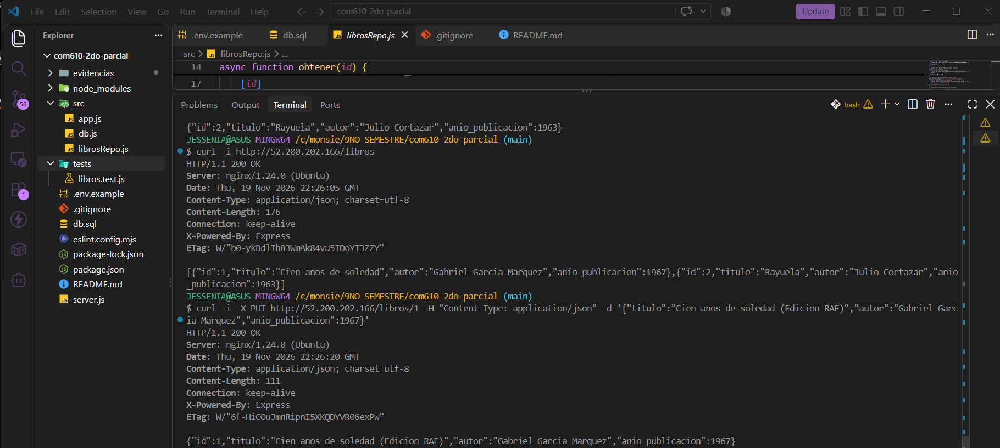

**Eliminar y comprobar el 404:**

**Comando:** curl -i -X DELETE http://52.200.202.166/libros/2

**Comando:** curl -i http://52.200.202.166/libros/2

- **-X DELETE**: elimina el libro con id 2.
- La segunda consulta pide el mismo libro y ahora responde 404, porque ya no existe.

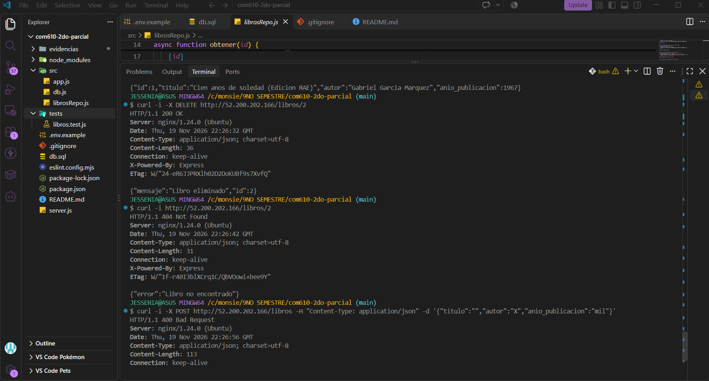

*También se ve que datos inválidos (título vacío y año "mil") responden **400** con la lista de errores.*

**Persistencia en RDS.** Desde la EC2 se consultó la tabla directamente:

**Sentencia:** USE db\_libros;

**Sentencia:** SELECT \* FROM libros;

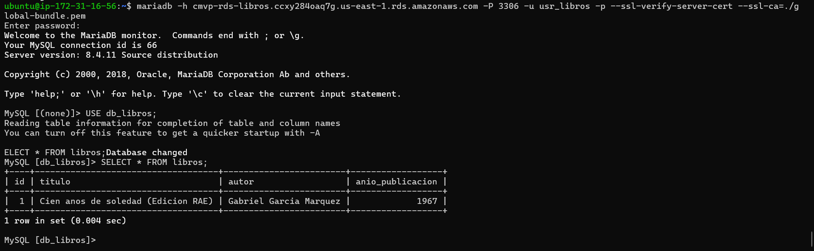

*El libro 1 aparece con el título actualizado y el libro 2 ya no existe: los cambios hechos por la API quedaron guardados en RDS y no en memoria.*

**Puertos cerrados.** Un id inexistente responde 404 en PUT y DELETE, y una petición directa al puerto 3000 no responde (*timeout*), porque no está abierto a Internet:

**Comando:** curl -m 5 http://52.200.202.166:3000/health

- **-m 5**: espera como máximo 5 segundos antes de rendirse.

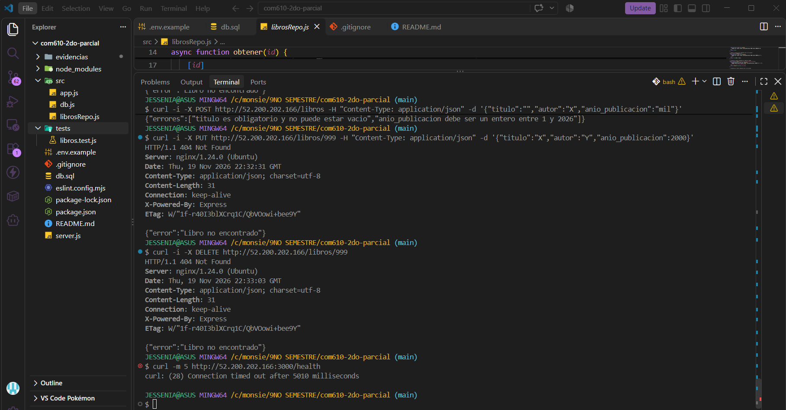

---

# Ejercicio 2: CI/CD para la API

**Objetivo:** automatizar las pruebas y el despliegue de la misma API, desde GitHub hasta la EC2 del ejercicio 1, sin pasos manuales y sin publicar credenciales.

## 2.1 Pruebas automatizadas sin RDS

Las pruebas están en tests/libros.test.js y usan **Jest** (ejecuta las pruebas) y **Supertest** (hace peticiones HTTP a la app sin levantar un servidor real).

Para no depender de RDS, la capa de datos se reemplaza por un **doble de prueba**:

**Código:** jest.mock('../src/librosRepo');

Esta línea cambia todas las funciones de librosRepo por funciones simuladas, y cada prueba decide qué devuelven. Por ejemplo, repo.obtener.mockResolvedValue(null) simula un libro que no existe.

Las 8 pruebas comprueban: GET /health, el listado, la creación válida (201), título vacío (400), año no entero (400) y el 404 de GET, PUT y DELETE.

**Comando:** npm test

- Ejecuta el script "test": "jest" definido en package.json.

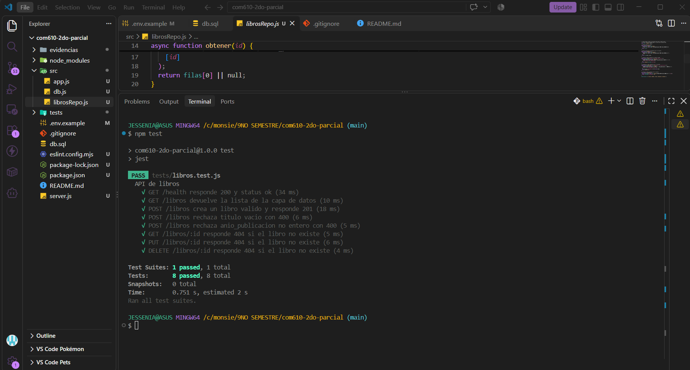

## 2.2 Workflow de CI

El archivo .github/workflows/ci.yml se ejecuta en cada **push** y en cada **pull request** hacia main:

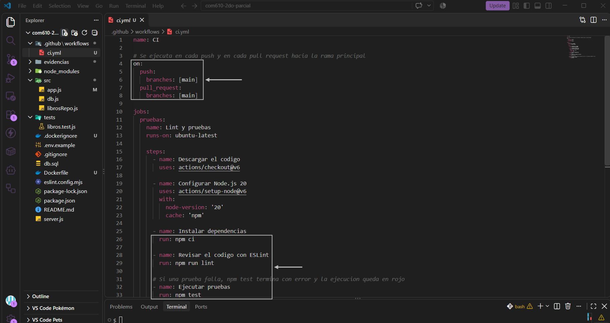

*Arriba: ci.yml se ejecuta con push y pull request hacia main. Abajo: los pasos npm ci, lint y npm test.*

Sus pasos son: descargar el código, configurar Node.js 20, npm ci (instalación exacta), npm run lint (revisión del código) y npm test. Si una prueba falla, npm test termina con error y la ejecución queda en rojo.

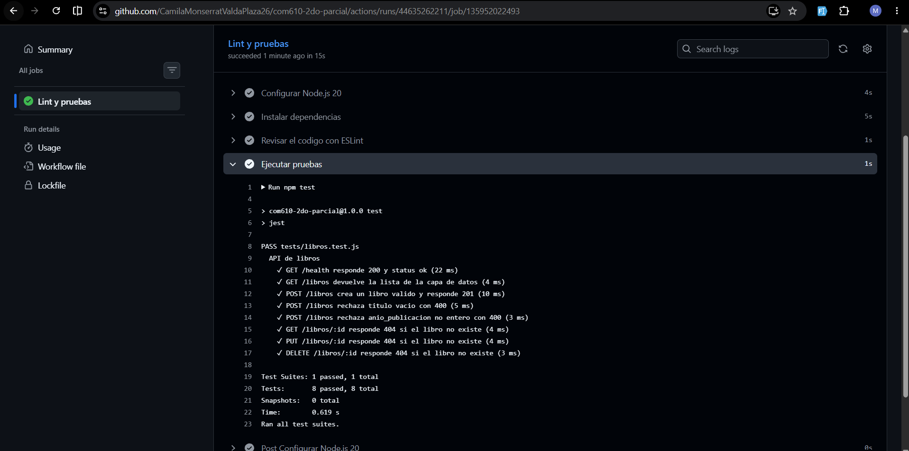

**Ejecución exitosa de CI:** https://github.com/CamilaMonserratValdaPlaza26/com610-2do-parcial/actions/runs/44635262211

## 2.3 Dockerfile y prueba local

El Dockerfile construye la imagen en dos etapas sobre node:20-alpine:

- **Etapa 1:** instala solo las dependencias de producción (npm ci --omit=dev).
- **Etapa 2:** copia node_modules, server.js y src/, y ejecuta la API con el usuario node (sin privilegios de administrador).
- **ARG GIT_SHA:** guarda dentro de la imagen el SHA del commit, que luego aparece en /health.

La configuración de RDS **no se copia a la imagen**; el .dockerignore además excluye .env, \*.pem, \*.key, las pruebas y las evidencias.

**Comando:** docker build -t api-libros:local .

- **docker build**: construye una imagen a partir del Dockerfile.
- **-t api-libros:local**: le pone nombre (api-libros) y etiqueta (local).
- **.**: usa la carpeta actual como contexto.

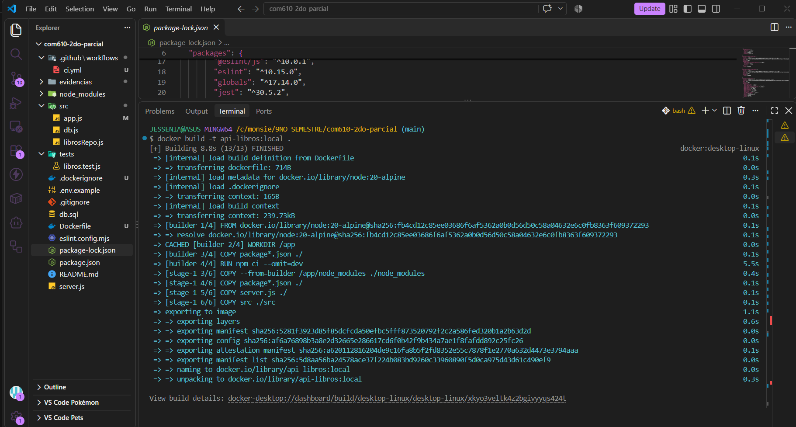

*La imagen se construyó sin errores.*

**Comando:** docker run -d --name api-libros-local -p 3000:3000 --env-file .env.example api-libros:local

- **-d**: ejecuta el contenedor en segundo plano.
- **--name**: le da un nombre para manejarlo después.
- **-p 3000:3000**: conecta el puerto 3000 del equipo con el 3000 del contenedor.
- **--env-file .env.example**: entrega la configuración como variables de entorno. Así se demuestra que la configuración llega desde fuera de la imagen.

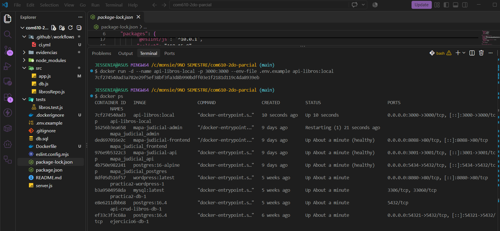

*El contenedor api-libros-local quedó en ejecución (Up).*

**Comando:** curl -i http://localhost:3000/health

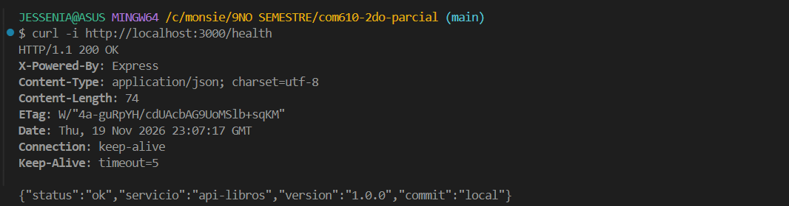

*El contenedor responde 200 con "commit":"local". Desde el equipo local /libros no funciona, porque RDS solo acepta conexiones desde la EC2.*

## 2.4 Preparación de la EC2

**Comando:** sudo apt install -y docker.io

**Comando:** sudo usermod -aG docker ubuntu

- **docker.io**: instala Docker desde los repositorios de Ubuntu.
- **usermod -aG docker ubuntu**: agrega (-a) al usuario ubuntu al grupo (-G) docker, para usar Docker sin sudo durante el despliegue automático.

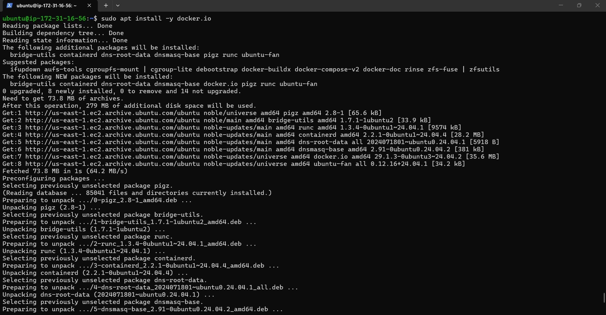

*Instalación de Docker en la EC2.*

**Comando:** cp ~/com610-2do-parcial/.env ~/api-libros.env

**Comando:** chmod 600 ~/api-libros.env

La configuración de RDS se movió a /home/ubuntu/api-libros.env, **fuera del repositorio y de la imagen**. El contenedor la recibe con --env-file.

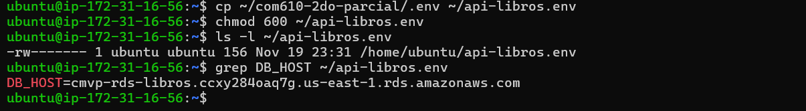

*-rw------- indica que solo el usuario ubuntu puede leer el archivo. grep DB_HOST muestra el endpoint sin revelar la contraseña.*

**Comando:** pm2 delete api-libros

**Comando:** pm2 save

Se detuvo la versión de PM2 para liberar el puerto 3000, que desde entonces usa el contenedor.

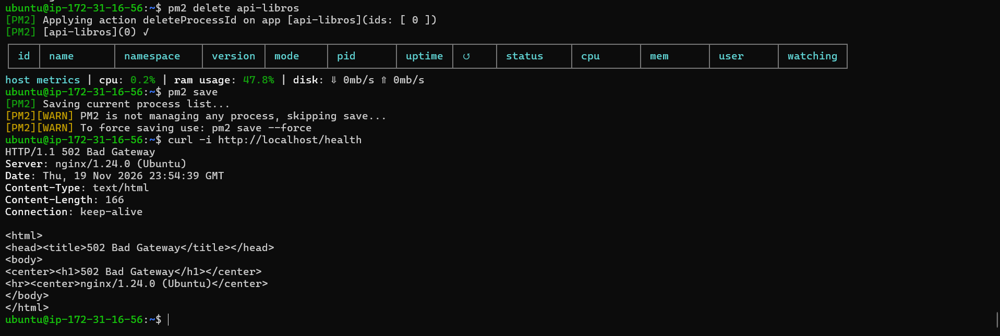

*PM2 detenido; Nginx responde 502 hasta el primer despliegue con Docker.*

## 2.5 Credenciales como secrets

En **Settings > Secrets and variables > Actions** se crearon 8 secrets. GitHub los guarda cifrados y en los registros aparecen como ***:

- **DOCKER_USERNAME** y **DOCKER_PASSWORD**: usuario y **token** de Docker Hub (no la contraseña de la cuenta).
- **SSH_HOST**, **SSH_USER** y **SSH_PRIVATE_KEY**: IP de la EC2, usuario y clave privada para la conexión SSH.
- **AWS_ACCESS_KEY_ID**, **AWS_SECRET_ACCESS_KEY** y **EC2_SG_ID**: credenciales de un usuario IAM y el grupo de seguridad de la EC2.

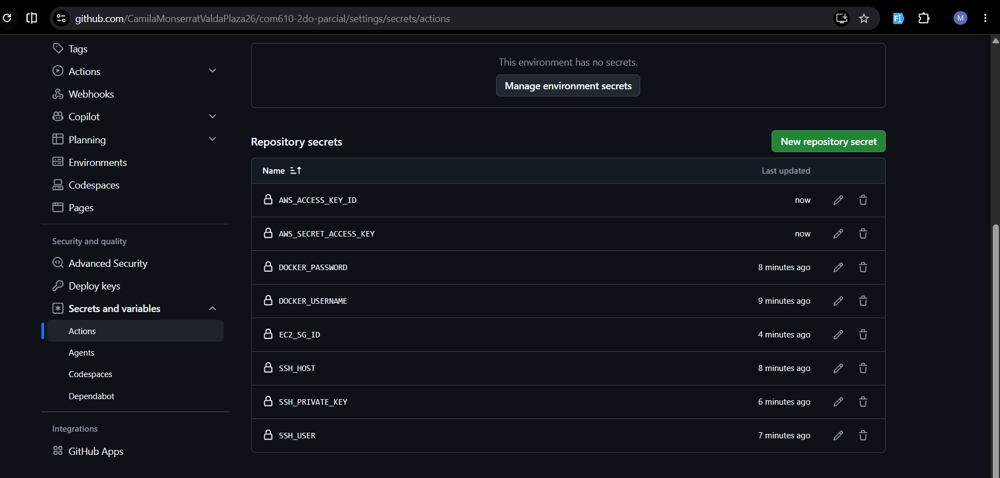

**¿Por qué un usuario IAM?** El grupo de la EC2 solo acepta SSH desde la IP del equipo local, y las IP de GitHub Actions cambian en cada ejecución. Se creó el usuario CMVP-github-deploy con una política que **solo** permite agregar y quitar reglas en ese grupo:

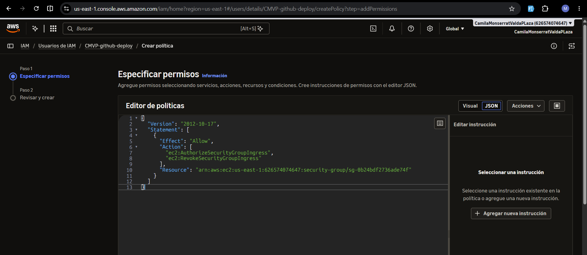

*La política solo permite agregar y quitar reglas de entrada en el grupo sg-0b24bdf2736ade74f.*

## 2.6 Workflow de CD

El archivo .github/workflows/cd.yml se ejecuta **solo con push a main**. Un pull request no lo dispara y, por lo tanto, no despliega:

**Disparador:** on: push, branches: [main]

Tiene **tres trabajos dependientes**. needs hace que cada uno espere a que el anterior termine bien:

1. **Ejecutar pruebas:** npm ci, lint y npm test.
2. **Construir y publicar imagen** (needs: pruebas): publica en Docker Hub monsievalda/api-libros:&lt;SHA del commit&gt; y latest.
3. **Desplegar en EC2** (needs: imagen):
   - obtiene la IP del runner con curl https://checkip.amazonaws.com;
   - abre el puerto 22 solo para esa IP con aws ec2 authorize-security-group-ingress;
   - se conecta por SSH y ejecuta el script de despliegue;
   - verifica /health y /libros desde Internet;
   - cierra la regla SSH con aws ec2 revoke-security-group-ingress, **aunque algo falle** (if: always()).

**Script de despliegue en la EC2:**

1. Guarda en PREV la imagen que está funcionando (docker inspect), para poder restaurarla.
2. Descarga la imagen nueva (docker pull).
3. La prueba en un puerto interno alterno, 127.0.0.1:3001, con curl -sf sobre /health y /libros (-s silencioso, -f falla si la respuesta no es exitosa). **Si no responde, termina con error y la versión activa no se toca.**
4. Si responde, reemplaza el contenedor activo, publicado solo en 127.0.0.1:3000, y vuelve a comprobar a través de Nginx. **Si falla, restaura PREV.**

-p 127.0.0.1:3000:3000 significa que el puerto 3000 solo es accesible desde la propia EC2; desde Internet solo se llega por Nginx en el puerto 80.

## 2.7 Primer despliegue automático

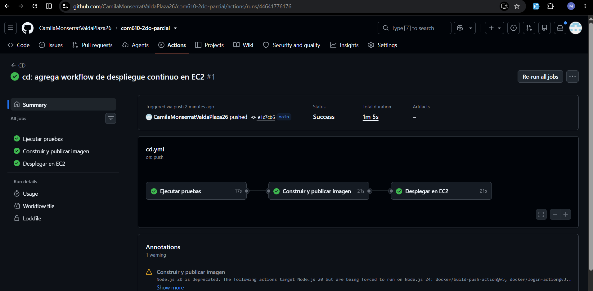

*Los tres trabajos se ejecutan uno después del otro y terminan en verde.*

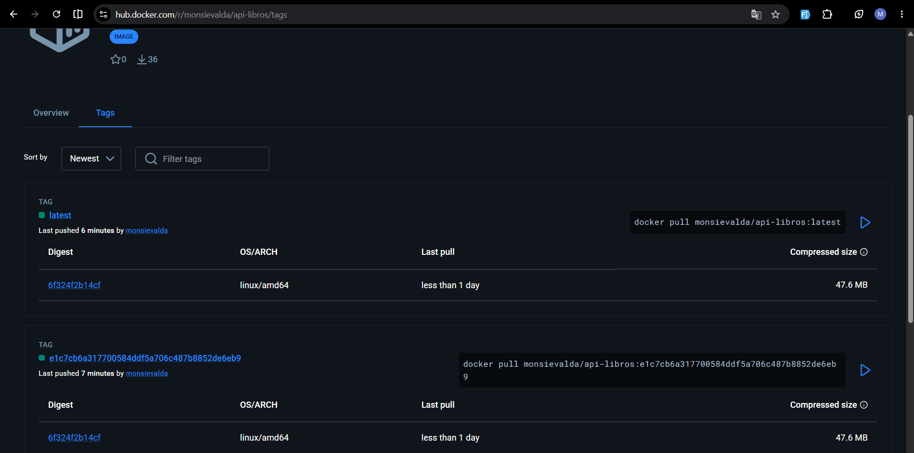

*En Docker Hub la imagen tiene el tag del SHA del commit y latest.*

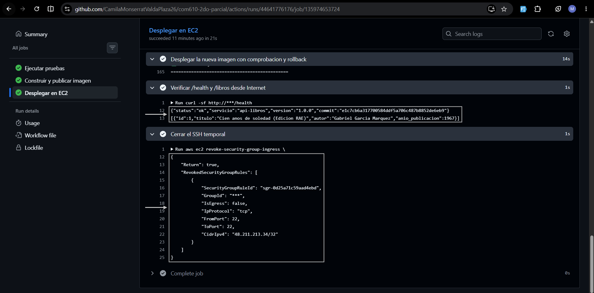

*El workflow comprueba /health y /libros desde Internet y luego elimina la regla SSH temporal.*

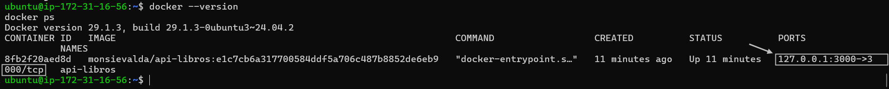

*docker ps en la EC2 muestra el contenedor con la imagen del SHA y el puerto 127.0.0.1:3000.*

**Ejecución exitosa de CD:** https://github.com/CamilaMonserratValdaPlaza26/com610-2do-parcial/actions/runs/44641776176

## 2.8 Cambio visible de versión

Se cambió const VERSION = '1.0.0' por '2.0.0' en src/app.js y se hizo push a main. Sin entrar a la EC2, el CD construyó y desplegó la nueva imagen.

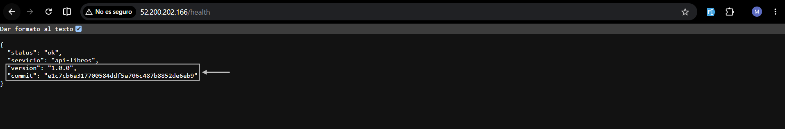

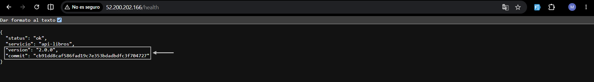

*/health pasó de la versión 1.0.0 (commit e1c7cb6) a la 2.0.0 (commit cb91dd8).*

**Ejecución exitosa de CD (versión 2.0.0):** https://github.com/CamilaMonserratValdaPlaza26/com610-2do-parcial/actions/runs/44644853092

## 2.9 Prueba de fallo: se conserva la versión anterior

Para probar la protección se subió una versión 3.0.0 con un error a propósito: server.js escuchaba en el puerto fijo 3005. Las pruebas pasaron, pero en la EC2 el contenedor no respondió en el puerto esperado.

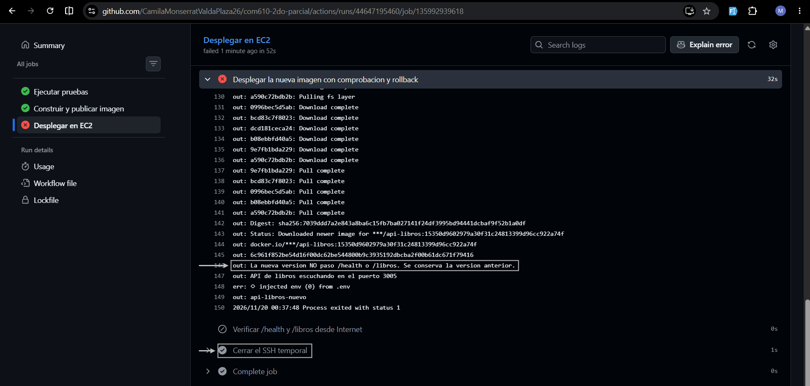

*El despliegue terminó con La nueva version NO paso /health o /libros. Se conserva la version anterior. y el SSH temporal se cerró igualmente.*

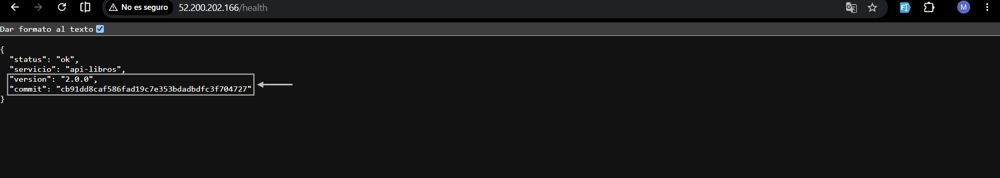

*Después del fallo, la API siguió respondiendo la versión 2.0.0.*

Luego se deshizo el error:

**Comando:** git revert HEAD --no-edit

**Comando:** git push origin main

- **git revert HEAD**: crea un commit nuevo que deshace el último cambio, sin borrar el historial.
- **--no-edit**: usa el mensaje automático, sin abrir un editor.

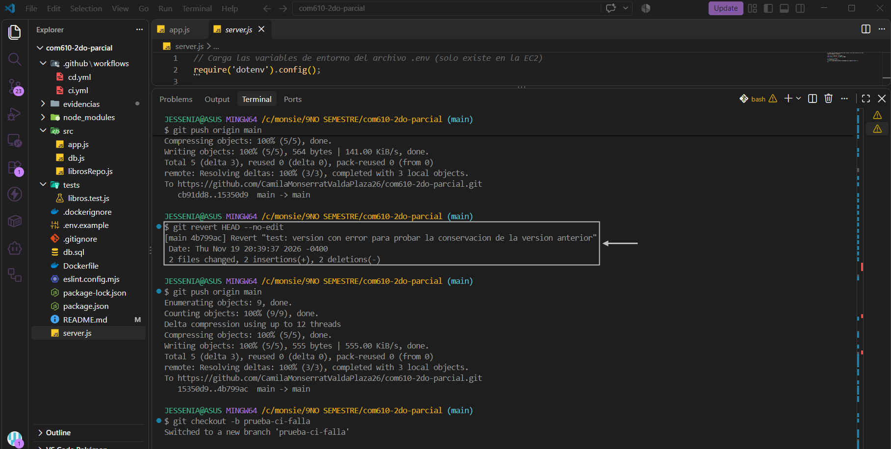

*git revert y push para volver a la versión correcta.*

- **Ejecución fallida:** https://github.com/CamilaMonserratValdaPlaza26/com610-2do-parcial/actions/runs/44647195460
- **Ejecución exitosa después del revert:** https://github.com/CamilaMonserratValdaPlaza26/com610-2do-parcial/actions/runs/44647649574

## 2.10 Pull request: el CI falla y no se despliega

Se creó una rama con una prueba rota a propósito (esperaba 500 en /health) y se abrió un pull request hacia main:

**Comando:** git checkout -b prueba-ci-falla

**Comando:** git push origin prueba-ci-falla

- **git checkout -b**: crea una rama nueva y se cambia a ella.
- **git push origin prueba-ci-falla**: sube esa rama, no main.

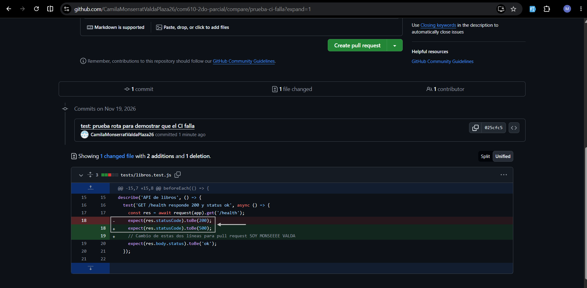

*El pull request solo cambia la prueba de /health para esperar 500 en lugar de 200.*

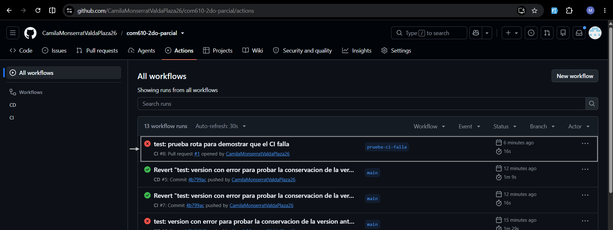

*El pull request ejecutó **solo el CI**, que terminó en fallo. No hay ninguna ejecución de CD para esa rama. El pull request se cerró sin fusionarse.*

- **Pull request:** https://github.com/CamilaMonserratValdaPlaza26/com610-2do-parcial/pull/1
- **CI fallido del pull request:** https://github.com/CamilaMonserratValdaPlaza26/com610-2do-parcial/actions/runs/44648413222

---

# Cumplimiento de requisitos

**Ejercicio 1**

- EC2 y RDS en la misma VPC, identificadas con CMVP, RDS sin acceso público: secciones 1.2 y 1.3.
- Grupos separados: 22 solo desde la IP local, 80 público, 3306 solo desde el grupo de la EC2, sin 3000 ni 3306 en Internet: sección 1.1 y 1.8.
- Tabla libros, db.sql y persistencia en RDS: secciones 1.4 y 1.8.
- API con Node.js, Express, variables de entorno y los 6 endpoints: secciones 1.5 y 1.6.
- Validación con 400 y consultas parametrizadas: sección 1.5.
- Nginx en el puerto 80 y CRUD verificado desde el equipo local: secciones 1.7 y 1.8.

**Ejercicio 2**

- Pruebas con Jest y Supertest sin RDS, npm test y package-lock.json: sección 2.1.
- ci.yml en push y pull request, falla si una prueba falla: secciones 2.2 y 2.10.
- Dockerfile probado localmente con configuración por variables de entorno: sección 2.3.
- cd.yml con pruebas, imagen con el SHA y despliegue en orden, solo desde main: secciones 2.6, 2.7 y 2.10.
- Secrets, configuración de RDS fuera del repositorio y de la imagen, puerto 3000 no expuesto: secciones 2.4, 2.5 y 2.6.
- Verificación de /health y /libros, conservación de la versión anterior y cambio visible de versión: secciones 2.7, 2.8 y 2.9.

---

# Conclusiones

- Separar los grupos de seguridad y usar el grupo de la EC2 como origen del puerto 3306 permite que la base de datos funcione sin estar expuesta a Internet.
- Nginx como proxy inverso deja un único punto de entrada (puerto 80) y mantiene la aplicación en un puerto interno.
- Simular la capa de datos con jest.mock permite probar la API en GitHub Actions sin depender de RDS.
- Etiquetar cada imagen con el SHA del commit hace posible saber exactamente qué versión está desplegada y volver a una anterior.
- Probar la nueva versión en un puerto alterno antes de reemplazar la activa evita que un error deje la API fuera de servicio, como se comprobó en la prueba de fallo.
- Abrir el SSH solo para el runner durante el despliegue mantiene la regla de seguridad del ejercicio 1 sin bloquear la automatización.
