# API REST de libros — EC2 + RDS + CI/CD

**Segundo examen parcial — Trabajando en la Nube (COM610)**
Universidad San Francisco Xavier de Chuquisaca · Semestre 2/2026
**Estudiante:** Valda Plaza Camila Monserrat · **Docente:** Ing. Marcelo Quispe Ortega

API REST para gestionar un catálogo de libros. Corre en **Amazon EC2**, guarda los datos en **Amazon RDS for MySQL** y se publica con **Nginx** en el puerto 80.

## URL pública de la API

| Qué | URL |
|---|---|
| API (página de inicio) | http://52.200.202.166 |
| Estado del servicio | http://52.200.202.166/health |
| Lista de libros | http://52.200.202.166/libros |

La IP es una **Elastic IP**, así que no cambia aunque la instancia se reinicie.

## Contenido del repositorio

| Archivo / carpeta | Para qué sirve |
|---|---|
| `server.js` | Arranca el servidor: carga el `.env` y escucha en el puerto 3000. |
| `src/app.js` | La API con Express: los endpoints, la validación y los códigos HTTP. |
| `src/librosRepo.js` | Las consultas SQL a la tabla `libros`, todas parametrizadas con `?`. |
| `src/db.js` | El pool de conexiones `mysql2` hacia RDS, configurado con variables de entorno. |
| `tests/libros.test.js` | Pruebas con Jest y Supertest que no necesitan RDS (la capa de datos se simula con `jest.mock`). |
| `db.sql` | Script que crea la base `db_libros` y la tabla `libros`. |
| `.env.example` | Plantilla de variables de entorno, solo con valores ficticios. |
| `evidencias/` | Capturas del examen, explicadas una por una en [evidencias/README.md](evidencias/README.md). |

El archivo `.env` real, las claves `.pem` y las contraseñas **no** están en el repositorio: el `.gitignore` los excluye.

## Recursos de AWS utilizados

Todos están en la región **us-east-1 (Norte de Virginia)**, dentro de la misma VPC predeterminada `vpc-0e74f945b159d53ec`, y se identifican con las iniciales **CMVP**.

| Recurso | Nombre | Configuración |
|---|---|---|
| Instancia EC2 | `CMVP-ec2-libros` | Ubuntu Server 24.04 LTS, t3.micro, disco gp3 de 16 GiB |
| Elastic IP | `CMVP-eip` | `52.200.202.166`, asociada a la EC2 |
| Par de claves | `CMVP-key` | RSA `.pem`, guardado solo en el equipo local |
| Instancia RDS | `cmvp-rds-libros` | MySQL 8.4, db.t3.micro, base `db_libros`, **acceso público: No** |
| Grupo de seguridad de EC2 | `CMVP-ec2-sg` | Entrada: SSH 22 solo desde la IP del equipo local (/32) y HTTP 80 desde `0.0.0.0/0` |
| Grupo de seguridad de RDS | `CMVP-rds-sg` | Entrada: MySQL 3306 solo desde el grupo `CMVP-ec2-sg` |

Los puertos **3000** (Node.js) y **3306** (MySQL) **no** están abiertos a Internet.

### ¿Cómo viaja una petición?

1. El usuario llama a la API desde Internet por el puerto **80** (HTTP).
2. **Nginx**, en la EC2, recibe la petición y la reenvía a la API.
3. La **API Node.js** la procesa en el puerto **3000**, que solo escucha dentro de la EC2 (`127.0.0.1`).
4. La API consulta **RDS** por el puerto **3306**, a través de la red privada de la VPC.

El usuario solo ve el puerto 80. El 3000 y el 3306 quedan dentro de AWS.

**Reglas de entrada de la EC2:** SSH solo desde la IP del equipo local y HTTP público.

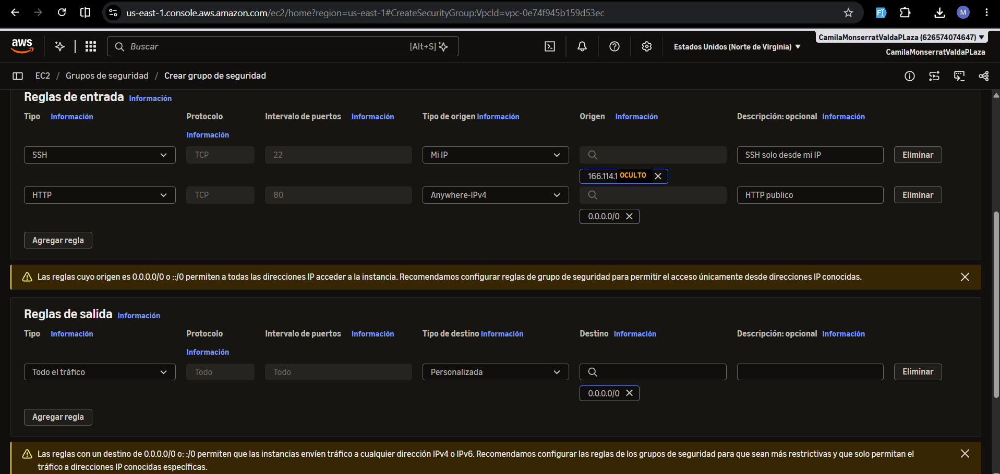

**Regla de entrada de RDS:** el puerto 3306 solo acepta conexiones desde el grupo de la EC2 (`sg-0b24bdf2736ade74f`).

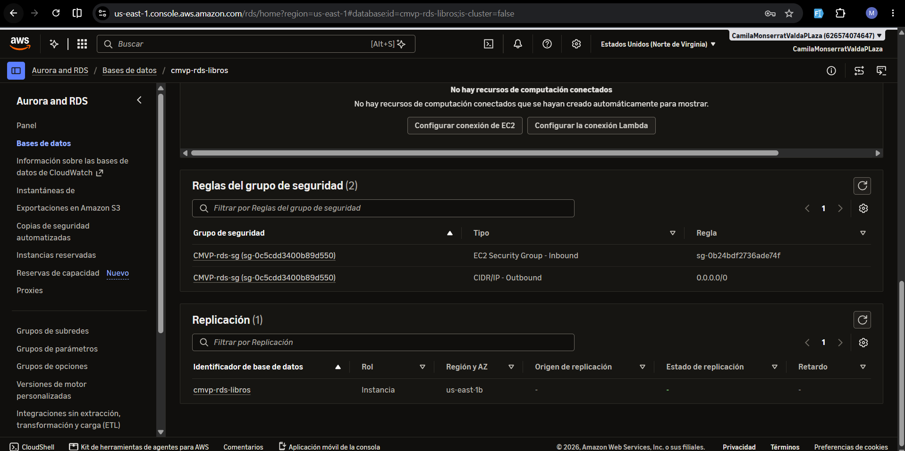

**RDS en la misma VPC y sin acceso público.**

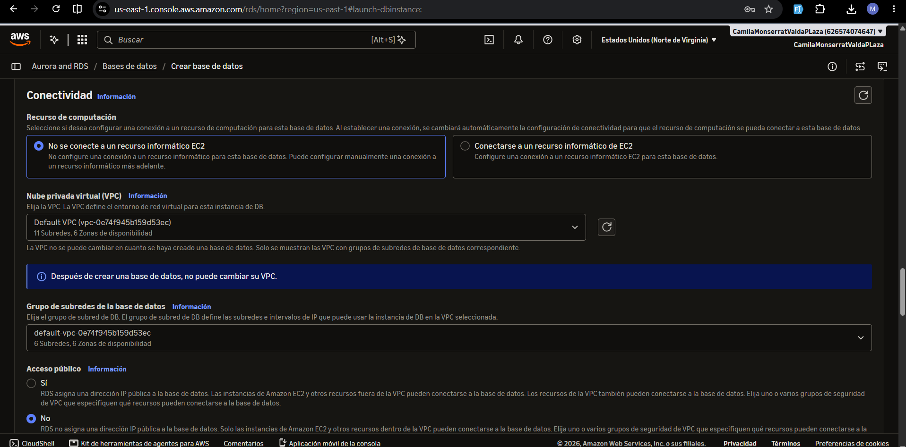

## Endpoints

- **`GET /health`**: indica que el servicio está activo y muestra su versión. Responde 200.
- **`GET /libros`**: lista todos los libros guardados en RDS. Responde 200.
- **`GET /libros/:id`**: devuelve un libro. Responde 200, o 404 si no existe.
- **`POST /libros`**: crea un libro. Responde 201 con el registro creado, o 400 si los datos son inválidos.
- **`PUT /libros/:id`**: actualiza un libro. Responde 200, 400 si los datos son inválidos o 404 si no existe.
- **`DELETE /libros/:id`**: elimina un libro. Responde 200, o 404 si no existe.

**Validación:** `titulo` y `autor` no pueden estar vacíos, y `anio_publicacion` debe ser un número entero entre 1 y el año actual. Si algo falla, la API responde **400** con la lista de errores. Un `id` que no es un número entero positivo también devuelve 400.

Ejemplo de cuerpo para `POST` y `PUT`:

```json
{ "titulo": "Rayuela", "autor": "Julio Cortazar", "anio_publicacion": 1963 }
```

## Variables de entorno

La API lee su configuración de un archivo `.env`, que solo existe en la EC2. Para crearlo se copia `.env.example` y se cambian los valores:

- **`PORT`**: puerto interno de la API (3000).
- **`DB_HOST`**: endpoint de RDS.
- **`DB_PORT`**: puerto de MySQL (3306).
- **`DB_USER`**: usuario de la API en MySQL (`usr_libros`, no el `admin`).
- **`DB_PASSWORD`**: contraseña de ese usuario.
- **`DB_NAME`**: base de datos (`db_libros`).
- **`DB_SSL`**: `true` para cifrar la conexión con el certificado de RDS.

## ¿Cómo ejecutar las pruebas?

Las pruebas **no necesitan RDS**: reemplazan la capa de datos por un doble de prueba. Se pueden correr en cualquier equipo con Node.js 20:

```bash
npm ci
```

Instala exactamente las versiones del `package-lock.json`.

```bash
npm test
```

Ejecuta las 8 pruebas con Jest y Supertest: `/health`, creación válida, rechazo de datos inválidos (400) y los 404 de GET, PUT y DELETE.

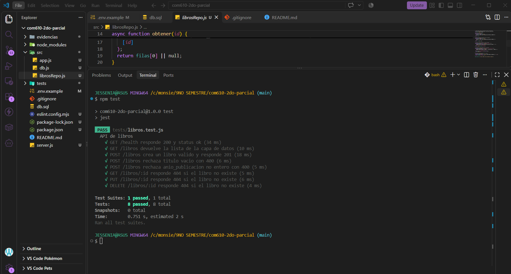

```bash
npm run lint
```

Revisa el código con ESLint.

## ¿Cómo ejecutar la API?

La API necesita llegar a RDS, y RDS solo acepta conexiones desde la EC2. Por eso se ejecuta **dentro de la EC2**.

### 1. Crear la tabla en RDS

Desde la EC2 se conecta a RDS con el cliente `mariadb` y se ejecuta `db.sql`:

```bash
mariadb -h ENDPOINT_RDS -P 3306 -u admin -p --ssl-verify-server-cert --ssl-ca=./global-bundle.pem < db.sql
```

`global-bundle.pem` es el certificado público de RDS. Se descarga con `curl -o global-bundle.pem https://truststore.pki.rds.amazonaws.com/global/global-bundle.pem`.

La tabla queda con sus 4 columnas:

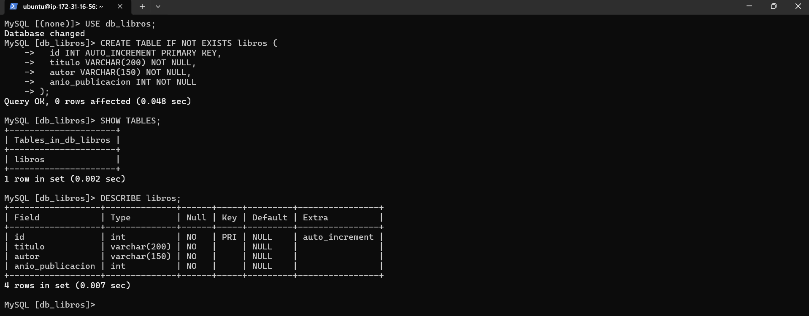

Después se crea un usuario solo para la API, con permisos únicamente sobre `db_libros`:

```sql
CREATE USER 'usr_libros'@'%' IDENTIFIED BY 'CONTRASENA_SEGURA';
GRANT ALL PRIVILEGES ON db_libros.* TO 'usr_libros'@'%';
FLUSH PRIVILEGES;
```

### 2. Instalar y configurar la API en la EC2

```bash
curl -fsSL https://deb.nodesource.com/setup_20.x | sudo -E bash -
sudo apt install -y nodejs git nginx
```

Se agrega el repositorio de Node.js 20 y se instalan Node.js, Git y Nginx.

```bash
git clone https://github.com/CamilaMonserratValdaPlaza26/com610-2do-parcial.git
cd com610-2do-parcial
npm ci --omit=dev
```

Se descarga el código y se instalan solo las dependencias de producción.

```bash
cp .env.example .env
nano .env
chmod 600 .env
```

Se crea el `.env` con el endpoint de RDS y la contraseña real, y se le asignan permisos para que solo el usuario `ubuntu` pueda leerlo.

### 3. Mantener la API activa con PM2

```bash
sudo npm install --global pm2
pm2 start server.js --name api-libros
pm2 save
pm2 startup
```

PM2 ejecuta la API en segundo plano. `pm2 save` y `pm2 startup` hacen que vuelva a arrancar sola si la EC2 se reinicia (`pm2 startup` imprime un comando `sudo env PATH=...` que hay que ejecutar).

### 4. Publicar con Nginx en el puerto 80

En `/etc/nginx/sites-available/libros-api` se configura Nginx como proxy inverso:

```nginx
server {
    listen 80 default_server;
    listen [::]:80 default_server;
    server_name _;

    location / {
        proxy_pass http://127.0.0.1:3000;
        proxy_http_version 1.1;
        proxy_set_header Host $host;
        proxy_set_header X-Real-IP $remote_addr;
        proxy_set_header X-Forwarded-For $proxy_add_x_forwarded_for;
        proxy_set_header X-Forwarded-Proto $scheme;
    }
}
```

```bash
sudo ln -s /etc/nginx/sites-available/libros-api /etc/nginx/sites-enabled/libros-api
sudo rm /etc/nginx/sites-enabled/default
sudo nginx -t
sudo systemctl reload nginx
```

Se activa el sitio, se quita la página por defecto, se comprueba que la configuración no tenga errores y se recarga Nginx.

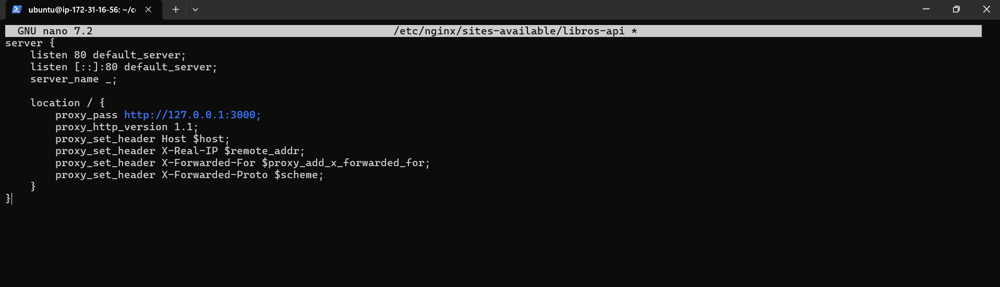

## ¿Cómo verificar el despliegue?

Desde cualquier equipo con `curl` (en este caso se usó Git Bash):

```bash
curl -i http://52.200.202.166/health
```

Debe responder **200** con `"status":"ok"`.

```bash
curl -i -X POST http://52.200.202.166/libros -H "Content-Type: application/json" -d '{"titulo":"Rayuela","autor":"Julio Cortazar","anio_publicacion":1963}'
```

Crea un libro: **201** con el registro y su `id`.

```bash
curl -i http://52.200.202.166/libros
```

Lista los libros: **200**.

```bash
curl -i -X PUT http://52.200.202.166/libros/1 -H "Content-Type: application/json" -d '{"titulo":"Rayuela (2da ed.)","autor":"Julio Cortazar","anio_publicacion":1963}'
```

Actualiza el libro 1: **200**, o **404** si no existe.

```bash
curl -i -X DELETE http://52.200.202.166/libros/1
```

Elimina el libro 1: **200**, o **404** si no existe.

### Resultado de las pruebas desde el equipo local

**Crear:** dos `POST` responden 201 Created. La cabecera `Server: nginx` muestra que pasaron por Nginx.

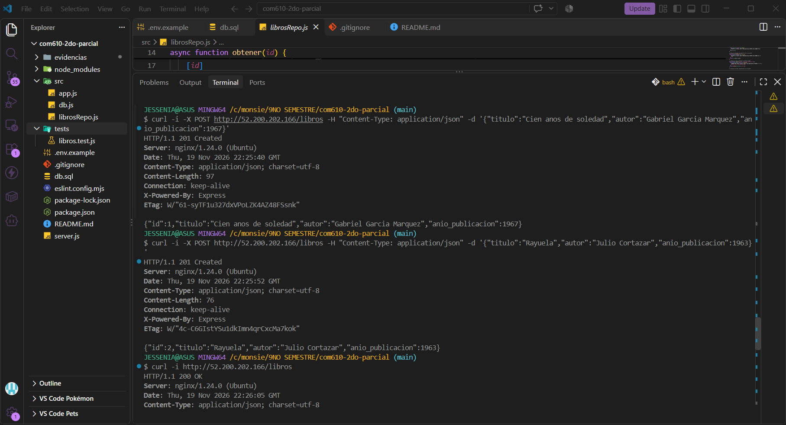

**Consultar y actualizar:** `GET /libros` responde 200 y `PUT /libros/1` responde 200 con el título nuevo.

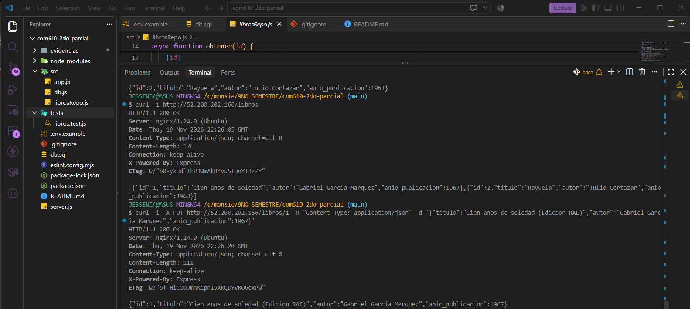

**Eliminar:** `DELETE /libros/2` responde 200 y luego `GET /libros/2` responde 404. Al final, datos inválidos responden 400.

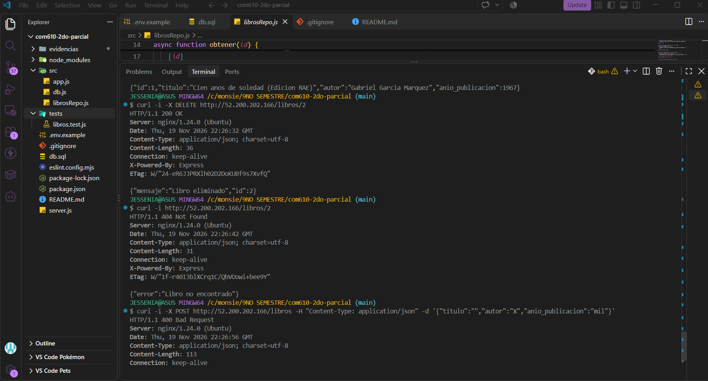

**Persistencia en RDS:** desde la EC2 se consulta `SELECT * FROM libros;`. El libro 1 está actualizado y el 2 ya no existe, así que los cambios se guardaron en RDS.

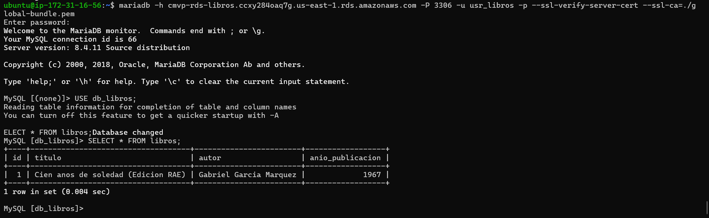

**404 en PUT y DELETE, y el puerto 3000 cerrado:** un id inexistente responde 404, y el puerto 3000 no responde desde Internet.

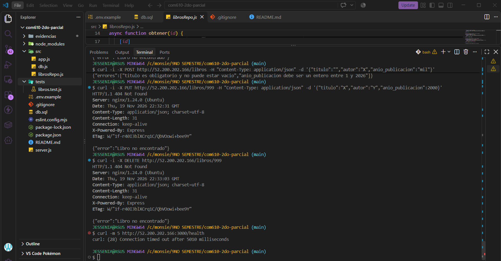

El resto de capturas, explicadas una por una, están en [evidencias/README.md](evidencias/README.md).

## Ejercicio 2 — CI/CD con GitHub Actions

*Sección en construcción: aquí se documentarán el workflow de CI, el Dockerfile, el workflow de CD y los enlaces a las ejecuciones exitosas.*

## Evidencias

Todas las capturas están en la carpeta [`evidencias/`](evidencias/). Su [README](evidencias/README.md) las muestra en orden y explica qué demuestra cada una, agrupadas por los criterios de evaluación del enunciado.
